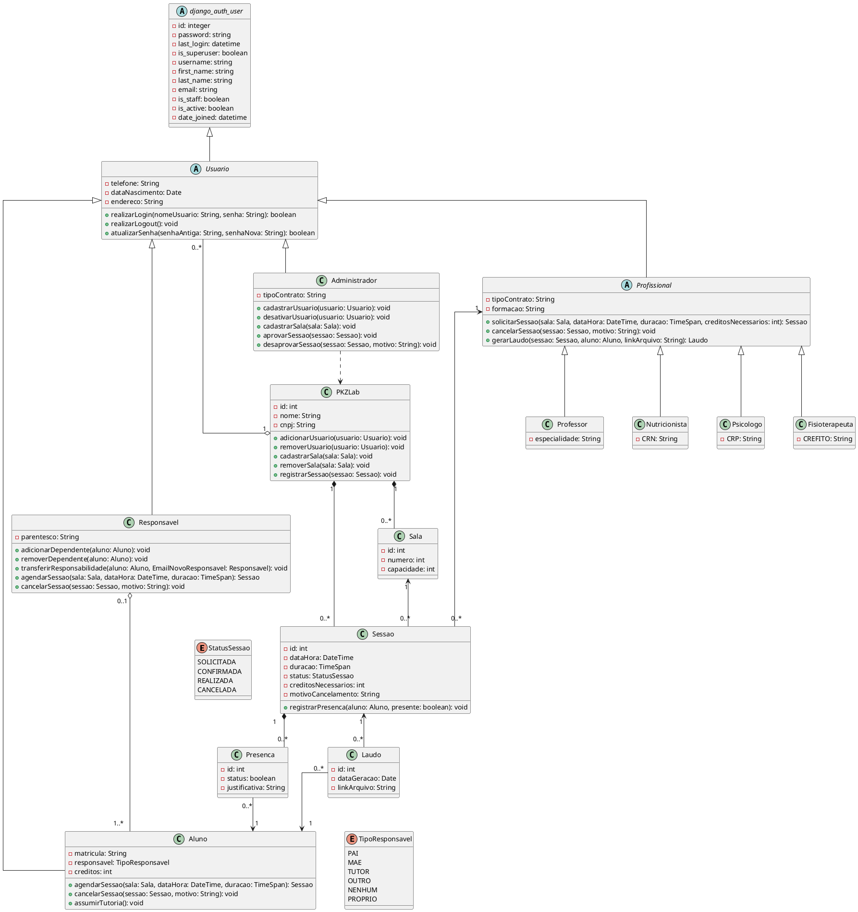

# Diagrama de Classes

## Objetivo

Representar os principais conceitos e entidades de domínio da PKZ Lab, detalhando a estrutura de usuários e papéis (integrados ao modelo de autenticação), salas, sessões operacionais, controle de presenças, geração de laudos e a gestão centralizada do sistema.

Diferente da versão inicial puramente conceitual, este modelo evolui para uma visão de **especificação/projeto**, detalhando atributos, tipos de dados, visibilidade, métodos e enums auxiliares.

## Diagrama

## Classes e Estruturas Representadas

### Núcleo de Domínio e Usuários

* **PKZLab**: Raiz agregadora que centraliza o cadastro de usuários, salas físicas e registro de sessões.
* **django_auth_user**: Classe base de autenticação do Django contendo credenciais e metadados de acesso.
* **Usuario**: Generalização base de perfil do domínio contendo dados pessoais e operações de conta.
* **Administrador**: Gerencia usuários, salas e realiza a moderação/aprovação de sessões.
* **Responsavel**: Agrega e gerencia dependentes (`Aluno`), podendo solicitar e cancelar sessões para eles.
* **Aluno**: Entidade atendida pelo sistema, associada a uma cota de créditos e dependência de tutoria.
* **Profissional**: Especialista multidisciplinar que solicita sessões, registra laudos e atende alunos.
* **Professor**, **Nutricionista**, **Psicologo**, **Fisioterapeuta**: Especializações com registros de conselho ou áreas de atuação específicas.

### Operação e Agendamento

* **Sala**: Espaço físico alocado para a realização de sessões com capacidade definida.
* **Sessao**: Evento que une profissional, sala, alunos e horário, gerido pelo ciclo de vida definido em `StatusSessao`.
* **Presenca**: Registro de comparecimento ou justificativa de ausência de um aluno em determinada sessão.
* **Laudo**: Documento e parecer técnico emitido por um profissional para um aluno com vínculo à sessão realizada.

### Enumeradores

* **StatusSessao**: Estados possíveis de uma sessão (`SOLICITADA`, `CONFIRMADA`, `REALIZADA`, `CANCELADA`).
* **TipoResponsavel**: Vínculos de parentesco e tutoria (`PAI`, `MAE`, `TUTOR`, `OUTRO`, `NENHUM`, `PROPRIO`).

## Relacionamentos Principais

* **Herança de Autenticação e Perfis**: `Usuario` herda de `django_auth_user`, sendo especializado em `Administrador`, `Responsavel`, `Aluno` e `Profissional`.
* **Especializações Profissionais**: `Profissional` especializa-se em `Professor`, `Nutricionista`, `Psicologo` e `Fisioterapeuta`.
* **Tutoria**: `Responsavel` agrega de 1 a muitos (`1..*`) dependentes do tipo `Aluno`.
* **Composição da Raiz (`PKZLab`)**: Agrega usuários (`0..*`) e compõe salas (`0..*`) e sessões (`0..*`).
* **Gestão Administrativa**: `Administrador` possui dependência de uso (`..>`) sobre `PKZLab` para execução de rotinas operacionais e moderação.
* **Alocação de Sessão**: Cada `Sessao` vincula-se a 1 `Profissional` e 1 `Sala`.
* **Acompanhamento e Registro**:
* Uma `Sessao` compõe múltiplos registros de `Presenca`, cada um associado a 1 `Aluno`.
* Uma `Sessao` referencia múltiplos registros de `Laudo`, cada um emitido para 1 `Aluno`.

## Observações

* O modelo foi atualizado da visão puramente conceitual para a visão de **especificação/projeto**, formalizando assinaturas de métodos, atributos, tipos e visibilidades.
* O mapeamento foi preparado para integração direta com a arquitetura do framework Django (utilizando a extensão da tabela `django_auth_user`).

## Histórico de Versões

| Data | Versão | Descrição | Autor(es) |
| --- | --- | --- | --- |
| 23/09/2026 | 1.0 | Criação da versão inicial (conceitual) | Brenno Marques Silva |
| 10/21/2026 | 1.1 | Atualização para diagrama de especificação (adição de métodos, atributos, visibilidade, herança Django e revisão das entidades operacionais) | Brenno Marques Silva |
